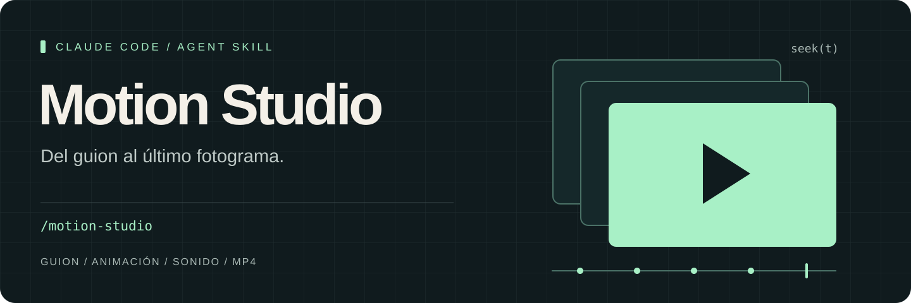

<p align="center">
  
</p>

<p align="center">
  <a href="https://claude.com/claude-code"></a>
  
  <a href="LICENSE"></a>
</p>

<p align="center">
  <a href="#instala-motion-studio">Instalación</a> · <a href="#úsala">Uso</a> · <a href="#mira-un-resultado">Demo</a> · <a href="#cómo-funciona">Cómo funciona</a> · <a href="#requisitos">Requisitos</a>
</p>

# /motion-studio

**Tu idea, convertida en movimiento. Tú decides cada fotograma.**

Motion Studio es una **skill para Claude Code** que guía la creación de videos con HTML y JavaScript: guion, animación, música sintetizada, revisión visual y exportación MP4. Cada fotograma depende de `window.seek(t)`, una función del tiempo que permite volver al mismo instante y comprobar el resultado.

El flujo usa Chrome sin interfaz con Playwright, la GPU que elijas y FFmpeg. No requiere un framework de video.

## Mira un resultado

[](ejemplo/XEON_motion_ejemplo.mp4)

**[Ver el video de XEON →](ejemplo/XEON_motion_ejemplo.mp4)** · 3 minutos · 1080p · 30 fps

La demo incluida es una copia ligera del video promocional de XEON. El original se renderizó a 60 fps con CRF 12. Consulta los [detalles del ejemplo](ejemplo/README.md).

## Instala /motion-studio

Desde la carpeta del proyecto donde usarás Claude Code:

```bash
npx skills add TuMinipeka/motion-studio-design --skill motion-studio --agent claude-code --copy
```

El comando descarga la skill **`motion-studio`** y la instala para **Claude Code** en el proyecto actual, bajo `.claude/skills/motion-studio/`. `--copy` copia los archivos y evita depender de enlaces simbólicos, especialmente en Windows. Si `npx` pide descargar el paquete `skills`, acepta para ejecutar su CLI.

Para tenerla disponible en **todos tus proyectos**, añade `--global`:

```bash
npx skills add TuMinipeka/motion-studio-design --skill motion-studio --agent claude-code --copy --global
```

Así se instala en `~/.claude/skills/motion-studio/` (`%USERPROFILE%\.claude\skills\motion-studio\` en Windows). Abre una sesión nueva de Claude Code al terminar.

**Comprueba la instalación:**

```bash
# Instalación en el proyecto
npx skills list --agent claude-code

# Instalación global
npx skills list --agent claude-code --global
```

`motion-studio` debe aparecer en la lista. Para consultar las skills del repositorio sin instalarlas:

```bash
npx skills add TuMinipeka/motion-studio-design --list
```

> [!NOTE]
> Instalar la skill añade instrucciones y plantillas al agente. Las herramientas de render se preparan aparte; consulta [Requisitos](#requisitos). No hace falta publicar un paquete npm propio: `npx` ejecuta la [CLI `skills`](https://github.com/vercel-labs/skills), que instala la habilidad desde GitHub.

<details>
<summary><strong>Alternativa: instalar desde una copia local del repositorio</strong></summary>

Clona el repositorio y entra en él:

```bash
git clone https://github.com/TuMinipeka/motion-studio-design.git
cd motion-studio-design
```

Windows (PowerShell), instalación global:

```powershell
.\install.ps1
```

macOS / Linux, instalación global:

```bash
bash ./install.sh
```

Para limitarla a este proyecto, usa `.\install.ps1 -Destino .claude\skills` o `bash ./install.sh .claude/skills`.

Estos scripts reemplazan la copia instalada de `motion-studio`. Abre una sesión nueva de Claude Code al terminar.

</details>

## Úsala

En Claude Code, dentro de tu proyecto:

```text
/motion-studio Crea un video de 20 segundos para presentar mi producto.
Quiero un guion por escenas, tipografía expresiva y música sintetizada.
```

También puedes pedirlo en lenguaje natural:

```text
Crea un video promocional de mi aplicación con Motion Studio.
Propón primero el guion y usa mi identidad visual.
```

La skill está descrita para que Claude Code la seleccione cuando pidas crear un video nuevo. La invocación `/motion-studio` permite elegirla directamente.

> [!IMPORTANT]
> Primero revisas y apruebas el guion. Después se crea el proyecto, se confirma la GPU y comienza la producción.

El resultado se organiza en una carpeta de video. La plantilla aporta el código base; durante la producción se añaden audio, revisión y exportaciones:

```text
mi-video/
├── index.html             Composición: window.seek(t) y window.ready
├── lib.js                 Easing y aleatoriedad con semilla
├── motion.config.json     Resolución, fps, duración, GPU y calidad
├── render.mjs             Captura de fotogramas y exportación
├── auditar.mjs            Comprobación estática del contrato
├── beats.json             Cuadrícula de pulsos musicales
├── sheet.py               Generación de hojas de contacto
├── audio/final.wav        Mezcla creada durante la producción
├── REVISION.md            Registro de la revisión visual
├── review/                Fotogramas y hojas de contacto
└── exportaciones/         Archivos MP4
```

## Cómo funciona

| Etapa | Qué ocurre |
| :--- | :--- |
| **01 · Guion** | Claude propone escenas, duración, mensajes y dirección visual. Tú apruebas antes de producir. |
| **02 · Composición** | Se crea el proyecto desde la plantilla y se anima con una función pura del tiempo. |
| **03 · Sonido** | Se sintetizan música y SFX, salvo que proporciones una pista; se sincronizan con pulsos medidos y se busca una mezcla a −14 LUFS. |
| **04 · Revisión** | Auditoría estática, prueba de determinismo y hojas de contacto. Se revisan seis criterios y se corrigen los tres peores hasta alcanzar al menos 8/10 en todos. |
| **05 · Exportación** | Borrador con CRF 16 o final con CRF 12 y preset `slow`. MP4 con H.264 y `yuv420p`. |

La revisión puntúa atención inicial, legibilidad en móvil, animación, variedad visual, identidad de marca y sincronización audiovisual. Es una evaluación guiada del agente, registrada en `REVISION.md`; no una garantía automática de calidad.

<details>
<summary><strong>Contrato de render y comandos de revisión</strong></summary>

Cada llamada a `window.seek(t)` debe dibujar el mismo fotograma para el mismo `t`, sin depender de llamadas anteriores. Durante el render no se usan relojes reales, `setTimeout`, `requestAnimationFrame`, transiciones CSS ni `Math.random`; el ruido usa semilla.

Desde la carpeta del video:

```bash
node auditar.mjs
node render.mjs --determinismo
node render.mjs --sheet
python sheet.py
```

Tras completar la revisión:

```bash
node render.mjs --borrador
node render.mjs --final
```

El render trabaja en segmentos de 5 segundos y permite reanudar los que faltan tras una interrupción. Comprueba el MP4 final con FFprobe antes de entregarlo.

</details>

### Elige tu GPU

El generador detecta GPU en Windows y escribe la selección en `motion.config.json`. Con varias GPU y sin preferencia explícita, propone la dedicada: confirma la elección antes de renderizar.

```json
{
  "gpu": {
    "modo": "alto-rendimiento",
    "angle": "d3d11",
    "coincidir": "NVIDIA",
    "nombre": "NVIDIA GeForce RTX 3050"
  }
}
```

El render informa del dispositivo WebGL real y avisa si obtiene otra GPU o SwiftShader. Consulta la [guía de GPU](motion-studio/references/gpu.md) para configurar otra tarjeta o resolver problemas.

## Requisitos

| Herramienta | Para qué se necesita |
| :--- | :--- |
| [Claude Code](https://claude.com/claude-code) | Leer y ejecutar la skill. |
| Node.js **22.20 o posterior**, con npm/npx | Ejecutar la CLI `skills` y el render JavaScript. |
| FFmpeg y FFprobe en el `PATH` | Codificar el MP4 y comprobar el archivo final. |
| Playwright y Chromium | Capturar los fotogramas en Chrome sin interfaz. |
| Python 3 y Pillow | Crear las hojas de contacto. |
| GPU con WebGL 2 | Renderizar la composición con aceleración gráfica. |

Después de aprobar el guion y crear la carpeta del video, prepara allí las dependencias de render:

```bash
npm install playwright
npx playwright install chromium
python -m pip install pillow
```

Verifica que las herramientas externas estén disponibles:

```bash
node --version
ffmpeg -version
ffprobe -version
python --version
```

> [!NOTE]
> El render solo se ha probado en **Windows 11, Direct3D 11 y NVIDIA RTX 3050**. Hay instalador para macOS/Linux, pero el render en esos sistemas no está validado. En Windows puedes usar `py -3` si tu instalación de Python no ofrece el comando `python`.

## Qué hay en este repositorio

| Ruta | Contenido |
| :--- | :--- |
| [`motion-studio/SKILL.md`](motion-studio/SKILL.md) | Instrucciones que carga Claude Code. |
| [`motion-studio/scripts/nuevo.py`](motion-studio/scripts/nuevo.py) | Generador de proyectos y detección de GPU. |
| [`motion-studio/assets/plantilla/`](motion-studio/assets/plantilla/) | Composición base, renderizador y herramientas de revisión. |
| [`motion-studio/references/gpu.md`](motion-studio/references/gpu.md) | Configuración y diagnóstico de GPU. |
| [`ejemplo/`](ejemplo/) | Video de XEON y notas de la demo. |
| [`install.ps1`](install.ps1) / [`install.sh`](install.sh) | Instalación manual para Claude Code. |

---

<p align="center"><strong>Un guion aprobado. Un instante reproducible. Un video tuyo.</strong><br><a href="motion-studio/SKILL.md">Explora la skill</a> · <a href="ejemplo/XEON_motion_ejemplo.mp4">Abre la demo</a></p>
