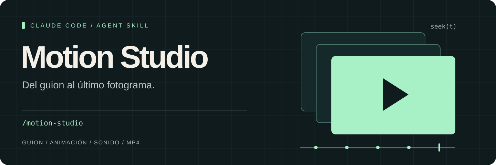

<p align="center">
  
</p>

<p align="center">
  <a href="https://agentskills.io"></a>
  
  <a href="LICENSE"></a>
</p>

<p align="center">
  <a href="#instala-motion-studio">Instalación</a> · <a href="#úsala">Uso</a> · <a href="#mira-un-resultado">Demo</a> · <a href="#cómo-funciona">Cómo funciona</a> · <a href="#requisitos">Requisitos</a>
</p>

# Motion Studio

**Tu idea, convertida en movimiento. Tú decides cada fotograma.**

Motion Studio es una **skill para agentes de IA**, independiente del proveedor, que guía la creación de videos con HTML y JavaScript: guion, animación, música sintetizada, revisión visual y exportación MP4. Cada fotograma depende de `window.seek(t)`, una función del tiempo que permite volver al mismo instante y comprobar el resultado.

El flujo usa Chrome sin interfaz con Playwright, la GPU que elijas y FFmpeg. No requiere un framework de video.

## Mira un resultado

[](ejemplo/XEON_motion_ejemplo.mp4)

**Escenas reales de un video creado con esta skill.** Un vistazo al diseño, la animación y la presentación del producto en 16 segundos, en bucle y sin sonido.

**[Ver el video completo con audio →](ejemplo/XEON_motion_ejemplo.mp4)** · 3 minutos · 1080p · 30 fps · [Vista estática](docs/assets/xeon-preview.jpg)

La vista previa y el MP4 proceden de la revisión v2 del video de XEON. La animación pesa aproximadamente **4 MB** y se muestra como imagen dentro del README; su reproducción depende de las preferencias de movimiento de GitHub. Consulta los [detalles del ejemplo](ejemplo/README.md).

## Instala /motion-studio

Desde la carpeta del proyecto donde usarás tu agente:

```bash
npx skills add TuMinipeka/motion-studio-design --skill motion-studio --copy
```

El comando descarga la skill **`motion-studio`** para el proyecto actual. Desde una terminal interactiva puedes elegir los agentes de destino; al ejecutarlo dentro de un agente, la CLI puede detectarlo automáticamente. `--copy` copia los archivos y evita depender de enlaces simbólicos, especialmente en Windows. Si `npx` pide descargar el paquete `skills`, acepta para ejecutar su CLI.

Para seleccionar un agente concreto, añade `--agent` con su identificador. Por ejemplo, `--agent claude-code`, `--agent cursor` o `--agent gemini-cli`. Consulta la [lista de agentes y rutas de instalación](https://github.com/vercel-labs/skills/blob/main/docs/agents.md) para elegir el tuyo. La compatibilidad del instalador no equivale a una prueba del flujo de video en cada agente.

Para tenerla disponible en **todos tus proyectos**, añade `--global`:

```bash
npx skills add TuMinipeka/motion-studio-design --skill motion-studio --copy --global
```

La ruta global depende del agente seleccionado. Abre una sesión nueva de tu agente al terminar si no recarga las skills automáticamente.

**Comprueba la instalación:**

```bash
# Instalación en el proyecto
npx skills list

# Instalación global
npx skills list --global
```

`motion-studio` debe aparecer en la lista. Puedes filtrar por agente añadiendo `--agent` con su identificador. Para consultar las skills del repositorio sin instalarlas:

```bash
npx skills add TuMinipeka/motion-studio-design --list
```

**Prepara las herramientas.** `npx skills add` solo copia archivos: no ejecuta instaladores. Después, ejecuta una vez el preparador desde la carpeta donde quedó la skill. Cambia `.claude` por la carpeta de tu agente (`.agents`, `.codex`…):

```bash
python ~/.claude/skills/motion-studio/scripts/preparar.py
```

Instala Playwright, Chromium, 12 fuentes, numpy y Pillow en `~/.motion-studio`, una carpeta compartida por todos los videos. También comprueba Node.js, FFmpeg (con libx264 y ebur128) y que Chrome obtiene tu GPU. Añade `--sistema` para que instale también Node.js y FFmpeg con winget, brew o apt. Si lo olvidas, el agente lo comprueba y lo ejecuta al empezar el primer video (Paso 0 del `SKILL.md`).

> [!NOTE]
> No hace falta publicar un paquete npm propio: `npx` ejecuta la [CLI `skills`](https://github.com/vercel-labs/skills), que instala la habilidad desde GitHub.

<details>
<summary><strong>Alternativa: instalar desde una copia local del repositorio</strong></summary>

Clona el repositorio y entra en él:

```bash
git clone https://github.com/TuMinipeka/motion-studio-design.git
cd motion-studio-design
```

Los scripts copian la carpeta completa a `~/.agents/skills/motion-studio/` por defecto. Esa ubicación sirve para agentes que la reconozcan; para cualquier otro, indica su directorio de skills.

Windows (PowerShell):

```powershell
.\install.ps1
```

macOS / Linux:

```bash
bash ./install.sh
```

Para limitarla a este proyecto, usa `.\install.ps1 -Destino .agents\skills` o `bash ./install.sh .agents/skills`. Puedes sustituir ese destino por el que requiera tu agente (por ejemplo, `.claude/skills` para Claude Code).

Estos scripts reemplazan la copia instalada de `motion-studio` y después ejecutan `preparar.py`, que deja listas las herramientas. Añade `-Sistema` (PowerShell) o `--sistema` (bash) para instalar también Node.js y FFmpeg. Con `-SinHerramientas`, o con `MOTION_SIN_HERRAMIENTAS=1` en bash, solo se copia la skill. Recarga las skills o abre una sesión nueva de tu agente al terminar.

Si tu agente no tiene descubrimiento de skills, indícale que lea `motion-studio/SKILL.md` y siga sus referencias relativas, conservando la carpeta completa con `scripts/`, `assets/` y `references/`.

</details>

## Úsala

En tu agente, dentro del proyecto, usa una petición en lenguaje natural:

```text
Usa la skill motion-studio para crear un video de 20 segundos de mi producto.
Quiero un guion por escenas, tipografía expresiva y música sintetizada.
```

También puedes pedirlo en lenguaje natural:

```text
Crea un video promocional de mi aplicación con Motion Studio.
Propón primero el guion y usa mi identidad visual.
```

La selección automática y la sintaxis de invocación dependen del agente. Si admite comandos de skill, usa su sintaxis correspondiente; por ejemplo, `/motion-studio` en Claude Code. En otros entornos, pide que lea el `SKILL.md` instalado y lo aplique.

> [!IMPORTANT]
> Primero se aclaran el público, el objetivo, el mensaje y el lenguaje de la referencia. Tras aprobar el brief, autorizas una muestra corta en calidad alta. Si te gusta, el aviso «Aprobar y generar el video completo en esta calidad» autoriza continuar directamente con esa misma calidad. El primer completo se revisa y corrige en calidad alta; un borrador reducido se genera solo si lo eliges expresamente. El renderizador no verifica estas aprobaciones automáticamente.

No necesitas llegar con referencias: el agente revisa el contexto disponible, propone una dirección y pregunta por las decisiones importantes que falten. Puedes consultar el [proceso de preproducción](motion-studio/references/preproduccion.md) y los [criterios de motion graphics y sus fuentes](motion-studio/references/motion-graphics.md).

Una referencia de un corto con personajes requiere analizar actuación, entorno y montaje; compartir sus colores o su tema no basta. La [guía de dirección de movimiento](motion-studio/references/direccion-movimiento.md) explica cómo detectar una deriva hacia diapositivas y comprobar una muestra en reproducción. El 2D y el 3D son elecciones del encargo; ninguno garantiza por sí solo el acabado.

**No necesitas conocer animación.** El agente dirige la realización y utiliza los avisos de preguntas con opciones que ofrezca tu entorno. Te propone alternativas creativas concretas, recomienda la más adecuada y explica lo que verás o sentirás. Resuelve cámara, poses y transiciones sin preguntarte por cada técnica. Si el agente no dispone de avisos nativos, usa mensajes breves con las mismas opciones. Consulta los [ejemplos de avisos creativos](motion-studio/references/avisos-creativos.md).

El resultado se organiza en una carpeta de video. La plantilla aporta el código base; durante la producción se añaden audio, revisión y exportaciones:

```text
mi-video/
├── BRIEF.md               Idea, guion, fuentes y autorizaciones por versión
├── STORYBOARD.md          Fichas por plano: intención, cámara, luz, acción, sonido y enlace
├── index.html             Composición: window.seek(t) y window.ready
├── lib.js                 Easing y aleatoriedad con semilla
├── motion.config.json     Resolución, fps, duración, GPU y calidad
├── render.mjs             Captura de fotogramas y exportación
├── auditar.mjs            Comprobación estática del contrato
├── beats.json             Cuadrícula de pulsos musicales
├── sheet.py               Generación de hojas de contacto
├── audio/final.wav        Mezcla creada durante la producción
├── REVISION.md            Registro de la revisión visual
├── review/                Fotogramas y hojas de contacto
└── exportaciones/         Archivos MP4
```

## Cómo funciona

| Etapa | Qué ocurre |
| :--- | :--- |
| **Preproducción** | El agente aclara la idea, estudia la referencia y recomienda una dirección. Prepara el brief y un storyboard con acciones, poses, encuadres, cámara, transiciones y sonido. Revisas una propuesta comprensible y autorizas las pruebas. |
| **Producción** | Se crea el proyecto y una muestra que resuelve las dificultades principales. Tras validar su movimiento, se desarrolla la animación con el lenguaje aprobado. El audio responde al brief y el render sigue siendo una función pura del tiempo. |
| **Postproducción** | Se revisan montaje, ritmo, continuidad, legibilidad y sonido. Aprobada la muestra y autorizada la continuación, el primer completo se exporta en la misma calidad alta con `--final`. La muestra y el completo usan `codificacion.final` (por defecto CRF 12/preset `slow`), resolución y fps del proyecto. `--borrador` es una alternativa opcional. |

El storyboard reúne una [ficha breve por plano](motion-studio/references/preproduccion.md#ficha-breve-por-plano): intención, cámara y composición, iluminación, acción, sonido y enlace, con identificador y tiempos. La guía incluye una plantilla y dos planos conectados de ejemplo. El agente resuelve esas decisiones y reutiliza lo común a cada escena; tú revisas una propuesta comprensible. Las fichas se revisan editorialmente; todavía no tienen validación automática.

La revisión puntúa claridad del mensaje, atención inicial, legibilidad en móvil, acción y fluidez, puesta en escena (encuadres, cámara, poses y transiciones), identidad de marca y sincronización audiovisual. Busca al menos 8/10 con evidencia por escena y propone hasta tres rondas antes de consultar los problemas persistentes. Lo que no pudo observarse queda pendiente. Es una evaluación del agente, registrada en `REVISION.md`; no una garantía automática de calidad. Las imágenes fijas no sustituyen la reproducción del primer completo en calidad alta para revisar ritmo y sonido.

<details>
<summary><strong>Contrato de render y comandos de revisión</strong></summary>

Cada llamada a `window.seek(t)` debe dibujar el mismo fotograma para el mismo `t`, sin depender de llamadas anteriores. Durante el render no se usan relojes reales, `setTimeout`, `requestAnimationFrame`, transiciones CSS ni `Math.random`; el ruido usa semilla.

Desde la carpeta del video:

```bash
node auditar.mjs
node render.mjs --determinismo
node render.mjs --prueba=2,6  # hasta 10 s; calidad final y audio/final.wav si existe
node render.mjs --sheet
python sheet.py
```

Tras completar la revisión y obtener autorización para el modo correspondiente:

```bash
node render.mjs --final  # completo con la misma calidad que la muestra aprobada
# Solo si el usuario elige una versión reducida:
# node render.mjs --borrador
```

La muestra incorpora la mezcla disponible, alineada al intervalo capturado; usa `--sin-audio` para una prueba visual. No normaliza por separado el fragmento. La cámara se revisa por su intención y por mantener el foco legible; pasar las métricas de ritmo no certifica calidad artística.

Consulta la [revisión de un episodio real](docs/analysis/2026-11-03-ojala-review.md) para ver los defectos encontrados, la comparación controlada y los límites de estas comprobaciones.

El render trabaja en segmentos de 5 segundos y permite reanudar los que faltan tras una interrupción. Comprueba el MP4 final con FFprobe antes de entregarlo.

</details>

### Elige tu GPU

El generador detecta GPU en Windows y escribe la selección en `motion.config.json`. Con varias GPU y sin preferencia explícita, propone la dedicada: confirma la elección antes de renderizar.

```json
{
  "gpu": {
    "modo": "alto-rendimiento",
    "angle": "d3d11",
    "coincidir": "NVIDIA",
    "nombre": "NVIDIA GeForce RTX 3050"
  }
}
```

El render informa del dispositivo WebGL real y avisa si obtiene otra GPU o SwiftShader. Consulta la [guía de GPU](motion-studio/references/gpu.md) para configurar otra tarjeta o resolver problemas.

## Requisitos

| Herramienta | Para qué se necesita |
| :--- | :--- |
| Un agente con soporte para Agent Skills o instrucciones Markdown | Leer la skill, trabajar con archivos, ejecutar comandos y revisar imágenes, directamente o con ayuda del usuario si falta alguna capacidad. |
| Node.js **22.20 o posterior**, con npm/npx | Ejecutar la CLI `skills` y el render JavaScript. |
| FFmpeg y FFprobe en el `PATH`, con libx264 y ebur128 | Codificar el MP4, medir la sonoridad y comprobar el archivo final. |
| Playwright y Chromium | Capturar los fotogramas en Chrome sin interfaz. |
| Python 3.9+, numpy y Pillow | Hojas de contacto, audio (`musica.py`) y verificación de ritmo (`ritmo.py`). |
| Fuentes @fontsource | Tipografía de títulos e interfaz sin descargas por proyecto. |
| GPU con WebGL 2 | Renderizar la composición con aceleración gráfica. |

Todo lo instala y verifica `scripts/preparar.py`. Los instaladores lo ejecutan solos, y `nuevo.py` lo repite al crear cada video:

```bash
python scripts/preparar.py              # instala lo que falte a nivel de usuario y verifica todo
python scripts/preparar.py --comprobar  # solo verifica
python scripts/preparar.py --sistema    # también Node.js y FFmpeg (winget/brew/apt)
```

Las herramientas compartidas viven en `~/.motion-studio`; puedes cambiar la ruta con la variable `MOTION_STUDIO_HOME`. El resultado de la última verificación, incluido el renderizador WebGL detectado, queda en `~/.motion-studio/estado.json`.

> [!NOTE]
> Los requisitos por funcionalidad (hardware mínimo y recomendado, versiones, comandos de verificación y alternativas) están en [requisitos.md](motion-studio/references/requisitos.md). El render solo se ha probado en **Windows 11, Direct3D 11 y NVIDIA RTX 3050**. Hay instalador para macOS/Linux, pero el render en esos sistemas no está validado. En Windows puedes usar `py -3` si tu instalación de Python no ofrece el comando `python`.

## Qué hay en este repositorio

| Ruta | Contenido |
| :--- | :--- |
| [`motion-studio/SKILL.md`](motion-studio/SKILL.md) | Instrucciones independientes del agente. |
| [`motion-studio/scripts/nuevo.py`](motion-studio/scripts/nuevo.py) | Generador de proyectos y detección de GPU. |
| [`motion-studio/scripts/preparar.py`](motion-studio/scripts/preparar.py) | Instalación y verificación de las herramientas (Playwright, Chromium, fuentes, numpy, Pillow, FFmpeg, GPU). |
| [`motion-studio/assets/plantilla/`](motion-studio/assets/plantilla/) | Composición base, renderizador y herramientas de revisión. |
| [`motion-studio/assets/plantilla/kit/`](motion-studio/assets/plantilla/kit/) | Kit de movimiento: cámara con encuadres, temblor y paralaje, transiciones entre planos y un ejemplo completo. |
| [`motion-studio/assets/edicion/`](motion-studio/assets/edicion/) | Modo edición de videos grabados: análisis, corte en papel, línea de tiempo, render con FFmpeg y control de calidad. |
| [`motion-studio/references/edicion.md`](motion-studio/references/edicion.md) | Flujo del modo edición, operaciones de la línea de tiempo, comprobaciones y qué está pendiente. |
| [`tests/edicion/`](tests/edicion/) | Material sintético con respuestas conocidas y prueba de principio a fin del modo edición, más la regresión del modo animación. |
| [`motion-studio/references/kit.md`](motion-studio/references/kit.md) | Guía del kit: principios de animación y timing, cómo diseñar y animar personajes, gramática de planos y transiciones. |
| [`motion-studio/references/gpu.md`](motion-studio/references/gpu.md) | Configuración y diagnóstico de GPU. |
| [`motion-studio/references/rubricas.md`](motion-studio/references/rubricas.md) | Rúbricas del 1 al 10 por funcionalidad: criterios medibles, errores frecuentes, detección, corrección y comprobación automática. |
| [`motion-studio/references/requisitos.md`](motion-studio/references/requisitos.md) | Requisitos por funcionalidad: sistemas, hardware, versiones, instalación, verificación, limitaciones y alternativas. |
| [`motion-studio/references/preproduccion.md`](motion-studio/references/preproduccion.md) | Clarificación de la idea, storyboard y aprobaciones antes del render. |
| [`motion-studio/references/motion-graphics.md`](motion-studio/references/motion-graphics.md) | Criterios visuales y fuentes de la investigación. |
| [`motion-studio/references/direccion-movimiento.md`](motion-studio/references/direccion-movimiento.md) | Análisis audiovisual de referencias, acciones y prueba animada antes de extender el estilo. |
| [`motion-studio/references/avisos-creativos.md`](motion-studio/references/avisos-creativos.md) | Preguntas breves con recomendaciones comprensibles, decisiones creativas y aprobaciones. |
| [`ejemplo/`](ejemplo/) | Video de XEON y notas de la demo. |
| [`install.ps1`](install.ps1) / [`install.sh`](install.sh) | Instalación manual con directorio de destino configurable. |
| [`CHANGELOG.md`](CHANGELOG.md) | Registro de mejoras, verificaciones y limitaciones. |
| [`CONTRIBUTING.md`](CONTRIBUTING.md) | Convención de commits y documentación de cambios. |

---

<p align="center"><strong>Un guion aprobado. Un instante reproducible. Un video tuyo.</strong><br><a href="motion-studio/SKILL.md">Explora la skill</a> · <a href="ejemplo/XEON_motion_ejemplo.mp4">Abre la demo</a></p>
